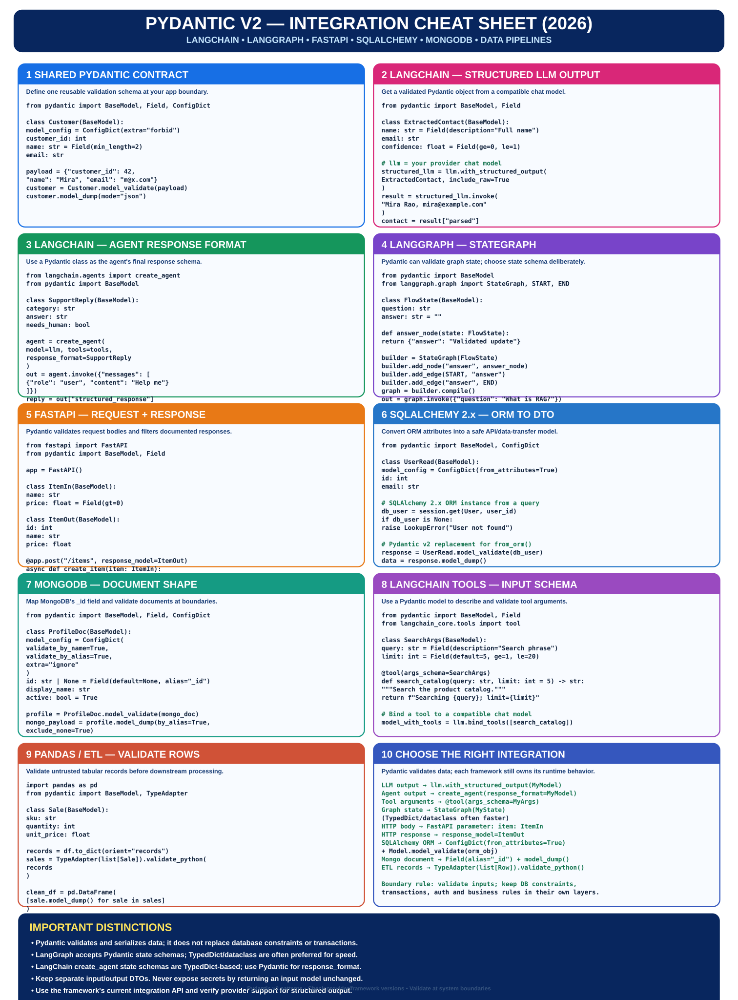
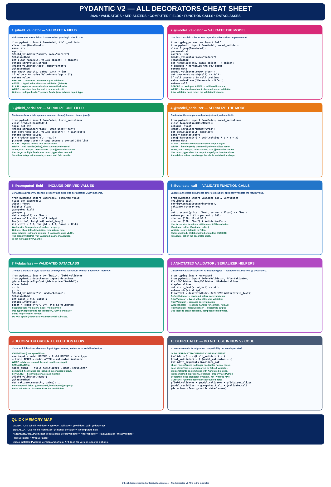

# Pydantic v2 Cheat Sheets (2026)

A practical, high-clarity reference collection for current Pydantic v2 usage.

## 1. Core Pydantic v2
[Open the core cheat sheet](./pydantic-v2-cheatsheet-2026.svg)

## 2. Pydantic v2 Across Frameworks

[Open the scalable integration cheat sheet](./pydantic-v2-integrations-cheatsheet-2026.svg)

Covers:
- LangChain model structured output with `with_structured_output`
- LangChain agents with `create_agent(response_format=...)`
- LangChain tools with Pydantic `args_schema`
- LangGraph `StateGraph` and the choice of state schema
- FastAPI request bodies and filtered response models
- SQLAlchemy 2.x ORM objects to Pydantic DTOs
- MongoDB document aliases and serialization
- Pandas / ETL row validation with `TypeAdapter`

## Important framework distinctions
- LangGraph supports Pydantic state schemas, but its documentation recommends `TypedDict` or dataclasses when performance is the priority. LangChain `create_agent` state schemas are TypedDict-based.
- Use a Pydantic model for an agent's structured response via `response_format`; the parsed response is returned in `structured_response`.
- Use separate request and response DTOs in APIs. Do not return credentials or private fields from an input schema.
- Pydantic validation does not replace database constraints, transactions, authorization, or business logic.

## Official documentation
- [Pydantic models](https://pydantic.dev/docs/validation/latest/concepts/models/)
- [Pydantic serialization](https://pydantic.dev/docs/validation/latest/concepts/serialization/)
- [LangChain structured output](https://docs.langchain.com/oss/python/langchain/structured-output)
- [LangGraph Graph API](https://docs.langchain.com/oss/python/langgraph/graph-api)
- [FastAPI response models](https://fastapi.tiangolo.com/tutorial/response-model/)
- [SQLAlchemy ORM](https://docs.sqlalchemy.org/en/20/orm/)

Examples target current Pydantic v2 patterns. Confirm the installed versions and provider/framework support before using a specific integration option.

## 3. All Pydantic v2 Decorators

[Open the scalable all-decorators cheat sheet](./pydantic-v2-all-decorators-2026.svg)

Covers the current Pydantic decorator set: `@field_validator`, `@model_validator`, `@field_serializer`, `@model_serializer`, `@computed_field`, `@validate_call`, and `pydantic.dataclasses.dataclass`. Also explains validator/serializer helpers for `Annotated` types and identifies deprecated v1 decorator names.

Official references: [Validators](https://pydantic.dev/docs/validation/latest/concepts/validators/), [Functional Validators API](https://pydantic.dev/docs/validation/latest/api/pydantic/functional_validators/), [Functional Serializers API](https://pydantic.dev/docs/validation/latest/api/pydantic/functional_serializers/), [Computed Fields](https://pydantic.dev/docs/validation/latest/concepts/fields/#the-computed_field-decorator), [Validate Call](https://pydantic.dev/docs/validation/latest/concepts/validation_decorator/), [Pydantic Dataclasses](https://pydantic.dev/docs/validation/latest/concepts/dataclasses/), [Migration Guide](https://pydantic.dev/docs/validation/latest/get-started/migration/).
